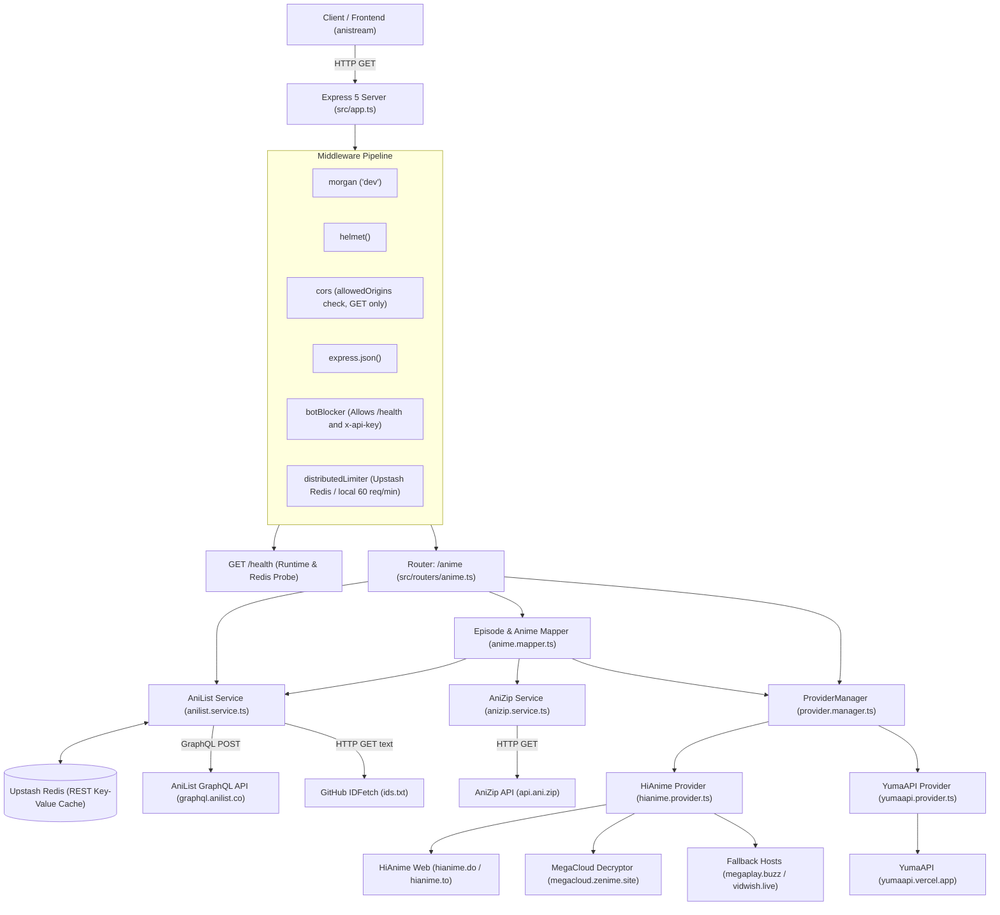

# anistream-api — System Specification & Architecture Blueprint

**Service Name**: `anistream-api`  
**Version**: 1.0.0  
**Repository**: `https://github.com/Firkhie/anistream-api.git`  
**License**: MIT  
**Runtime**: Node.js (ESNext / NodeNext modules)  
**Package Manager**: `pnpm` (v12)  
**Deployment**: Vercel Serverless Function (`api/index.ts` + `vercel.json`) / Node standalone listener  
**Testing**: Vitest 3.2.4  
**Primary Port**: `3000` (configurable via `PORT` environment variable)

---

## 1. System Overview & Architecture

`anistream-api` is a stateless backend aggregation and scraping service. It provides REST API endpoints for anime discovery, schedules, catalog details, characters, episode lists, server selections, stream links, and health diagnostics. It does not own a persistent database; instead, it coordinates upstream GraphQL queries, third-party REST APIs, HTML scraping, stream decryption proxies, and an optional Upstash Redis fail-open cache.



---

## 2. Complete File & Module Inventory

| File Path | Module Responsibility |
| :--- | :--- |
| `api/index.ts` | Vercel Serverless Function entrypoint exporting the configured Express `app` instance. |
| `vercel.json` | Vercel routing configuration rewriting all incoming routes `/(.*)` to `/api`. |
| `src/index.ts` | Standalone server entrypoint. Binds `app.listen()` on `PORT` in non-serverless environments. Attaches `EADDRINUSE` listener. |
| `src/app.ts` | Express application instance configuration. Attaches `morgan`, `helmet`, dynamic origin validator `cors({ methods: ["GET"] })`, `express.json()`, `botBlocker` (whitelisting `/health`), `distributedLimiter` (Upstash Redis or in-memory fallback), mounts `GET /` and `GET /health`, attaches `/anime` router, and registers 404/error middlewares. |
| `src/env.ts` | Validates environment variables with Zod (`NODE_ENV`, `PORT`, `ALLOWED_ORIGINS`, `API_SECRET_KEY`, `UPSTASH_REDIS_REST_URL`, `UPSTASH_REDIS_REST_TOKEN`). |
| `src/redis.ts` | Resilient Upstash Redis client instantiation and `getOrSetCache` fail-open cache-aside helper. |
| `src/middlewares.ts` | Contains `notFound` (returns 404) and `errorHandler` (sets 500 fallback status, hides stack trace in production). |
| `src/routers/index.ts` | Root Express router mounting `/anime` to the anime router. |
| `src/routers/anime.ts` | Defines 12 HTTP GET routes. Errors are passed to `sendError` to return accurate HTTP status codes (400, 502, 500). |
| `src/mappers/anime.mapper.ts` | Resolves cross-provider IDs (`animeMapper`) and compiles combined episode lists (`episodeMapper`) by pulling episode indices from HiAnime or YumaAPI and merging metadata (titles, thumbnails, air dates) from AniZip. |
| `src/utils/errors.ts` | Typed HTTP error hierarchy (`HttpError`, `BadRequestError`, `NotFoundError`, `UpstreamError`) and centralized `sendError` response helper. |
| `src/utils/helper.ts` | Helpers: `getSeason()`, `cleanQueries()`, `findSimilarTitles()`, `cleanTitle()`, `calculateSimilarity()`, and `checkRequestedServers()`. |
| `src/providers/anilist/anilist.enums.ts` | Enums matching AniList GraphQL schema. |
| `src/providers/anilist/anilist.fetch.ts` | HTTP POST fetch helper to `https://graphql.anilist.co` and HTTP GET helper to GitHub raw `IDFetch/ids.txt`. |
| `src/providers/anilist/anilist.queries.ts` | Raw GraphQL query strings for details, characters, search, airing schedule, and titles. |
| `src/providers/anilist/anilist.service.ts` | Implements `getAnilistByPreset` (with Upstash Redis caching), `getAnilistBySearch`, `getAnilistAiringSchedule`, `getAnilistDetailByRandom`, `getAnilistDetailById`, `getAnilistCharactersById`, and `getAnilistTitleById`. |
| `src/providers/anizip/anizip.service.ts` | Fetches AniZip mappings from `https://api.ani.zip/mappings?anilist_id=${id}` and normalizes episode dictionaries into standard `AnizipEpisodesResponse`. |
| `src/providers/provider.interface.ts` | Polymorphic interface definitions (`IStreamingProvider`, `ProviderName`, `ProviderEpisodesResult`, `ProviderServer`, `StreamSourceResult`, `StreamingLink`). |
| `src/providers/provider.manager.ts` | Centralized `ProviderManager` with provider registry, priority ranking, and automated fallback (`getEpisodesWithFallback`, `getSourceWithFallback`). |
| `src/providers/hianime/hianime.provider.ts` | Implements `IStreamingProvider` for HiAnime. |
| `src/providers/hianime/hianime.service.ts` | Provider facade orchestrating search, episode list, servers, and decrypted HLS stream sources. |
| `src/providers/yumaapi/yumaapi.provider.ts` | Implements `IStreamingProvider` for YumaAPI. |
| `src/providers/yumaapi/yumaapi.service.ts` | Implements YumaAPI episodes and stream sources fetching. |
| `test/app.test.ts` | Integration tests verifying `GET /` and `GET /health` (validating status, timestamp, uptime, and redis connection status). |
| `test/anime.routes.test.ts` | Integration tests verifying 400 parameter validations, 404 handler, and 502 upstream errors. |
| `test/errors.test.ts` | Unit tests verifying `HttpError` subclasses and `sendError` formatting. |
| `test/providers.test.ts` | Unit tests for `ProviderManager` registration, priority ordering, and fallback execution. |
| `package.json` | Package manifest with scripts: `pnpm dev`, `pnpm build`, `pnpm start`, `pnpm test`, `pnpm typecheck`, `pnpm lint`. |
| `tsconfig.json` | TS compiler config including `api/**/*.ts`, `src/**/*.ts`, and `test/**/*.ts`. |
| `.env.sample` | Sample environment variables template. |

---

## 3. Storage Schema & Data Flow

### Key-Value Caching: Upstash Redis
- Initialized in `src/redis.ts` when both `UPSTASH_REDIS_REST_URL` and `UPSTASH_REDIS_REST_TOKEN` are present.
- Uses **fail-open** architecture: if Redis credentials are unset or the network fails, queries execute against upstream providers normally without throwing errors.
- Cached TTLs:
  - Details: 86,400s (24 hours)
  - Characters: 259,200s (3 days)
  - Airing Schedule: 10,800s (3 hours)
  - Presets (Popular, Trending, Upcoming): 604,800s (7 days)
  - Newest: 10,800s (3 hours)

---

## 4. API Endpoints & Route Contracts

### System Diagnostics

#### `GET /health`
Validates server operational state and active Redis connectivity.
- **Bot Blocker**: Explicitly whitelisted (never blocked with 403).
- **Response**:
  ```json
  {
    "status": "ok",
    "timestamp": "2026-10-14T03:00:00.000Z",
    "uptime": 120,
    "redis": "healthy"
  }
  ```
  *(Returns `"redis": "disabled"` if unconfigured, or `"redis": "unreachable"` if network fails).*

### Anime Endpoints (`/anime/*`)
| Method | Endpoint | Query Parameters | Description |
| :--- | :--- | :--- | :--- |
| `GET` | `/anime/popular` | `page`, `perPage` | Popular anime preset |
| `GET` | `/anime/trending`| `page`, `perPage` | Trending anime preset |
| `GET` | `/anime/newest` | `page`, `perPage` | Recently updated anime |
| `GET` | `/anime/upcoming`| `page`, `perPage` | Upcoming anime preset |
| `GET` | `/anime/search` | Multiple query filters | Multi-dimensional catalog filter |
| `GET` | `/anime/detail/:id` | None | Full metadata & relations |
| `GET` | `/anime/detail/:id/characters` | `page`, `perPage` | Character cast & voice actors |
| `GET` | `/anime/airing` | `days`, `page`, `perPage` | Airing schedule countdowns |
| `GET` | `/anime/episodes/:id` | `provider` (`anilist` \| `hianime` \| `yumaapi`) | Episode listing |
| `GET` | `/anime/servers` | `id` | Streaming servers for episode |
| `GET` | `/anime/stream` | `id`, `source`, `server`, `type` | Playable HLS stream URL & subtitles |
